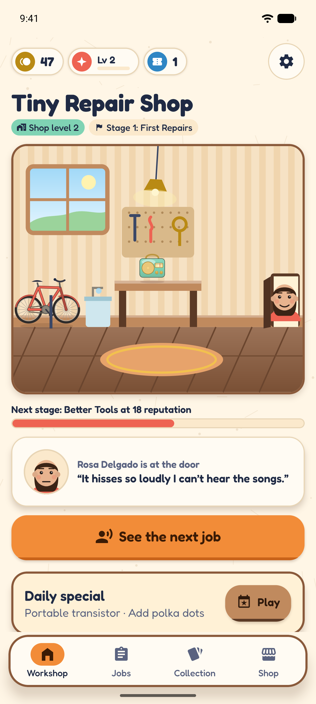
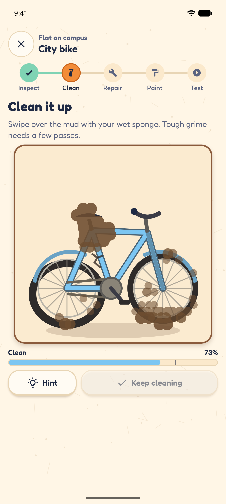
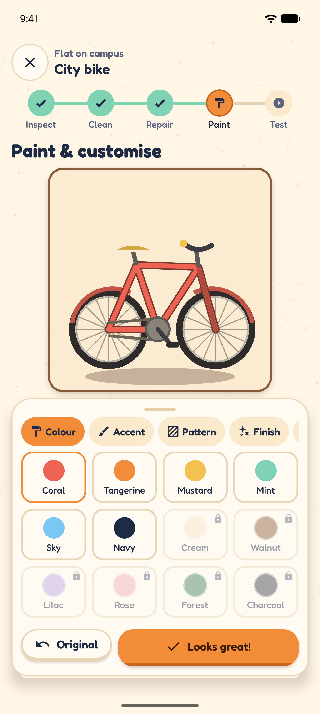
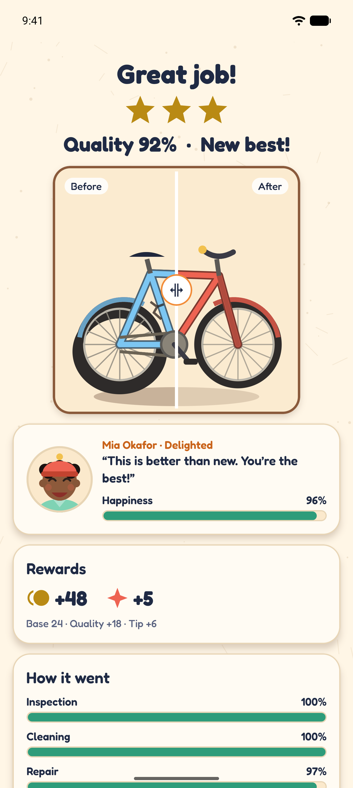

# Tiny Repair Shop

A cozy, offline repair-workshop game for iOS and Android. Customers bring in broken radios, bicycles,
robots, instruments, cameras and arcade machines. You inspect each object, clean it, fix it in
hands-on mini-games, paint it and test it, then hand it back and watch the customer's reaction.

Made by **Medin Turkes**.

<p>
  
  
  
  
</p>

All screenshots are listed in [docs/screenshots](docs/screenshots/README.md).

## The game

Every job has seven stages:

1. **Job board.** Pick a customer. Each job shows its difficulty, priority, reward and any special request.
2. **Inspection.** Tap suspicious spots, turn the object around, zoom and listen, then choose the fault from three options. Exploring is never punished, and gentle hint rings appear after 9 seconds.
3. **Cleaning.** Scrub dust, grease, rust or mud off a Skia canvas. Dirt is modelled per cell, tough grime needs several passes, and clean areas sparkle. You can finish at 80 % or polish to 100 %.
4. **Repair.** One to three mini-games per job, drawn from 22 task types across six object categories. Examples: wires and circuits, battery polarity, tuning dials, chains, bolts, tyre pumping, wheel truing, robot memory, guitar tuning, lens alignment, pixel repair and joystick calibration.
5. **Paint & customise.** Base and accent colours, patterns, finishes, stickers and an accessory, with a live paint-spread preview. Special requests are checked live.
6. **Testing.** A short, real test per category: tune the radio, hop the bike over bumps, repeat the robot's wake-up code, play the melody, snap a photo at the right moment, or hit arcade targets.
7. **Delivery.** A before/after slider, a quality score with stars, the customer's mood and words, coins, reputation and tickets, and any unlocks.

**Progression**
- 30 campaign jobs in 6 stages, unlocked by reputation.
- 16 customers with 8 personalities (perfectionist, busy, sentimental, collector, student, inventor, musician and grandparent). Each personality judges a repair differently.
- 11 workshop upgrades, all visible in the workshop scene. Some unlock categories, and others make tools more forgiving, enlarge the brush, cheer customers up or raise payouts.
- A daily special seeded by the date, which is the same for everyone that day.
- A collection of every restored object.

**Accessibility**
- Every control has a label and role.
- Status is always shown as text, never by colour alone.
- Touch targets are at least 52 dp.
- Reduced motion follows both the OS setting and an in-game toggle.
- High contrast mode is available.
- Every drag interaction has a tap or button alternative.

**Privacy.** There are no accounts, network calls, ads or analytics. Progress lives in AsyncStorage on the device only. Monetization is limited to an offline provider interface in [src/services/monetization.ts](src/services/monetization.ts). No real payments are wired in.

## Tech stack

| | |
|---|---|
| Framework | Expo SDK 57, React Native 0.86, React 19, TypeScript (strict) |
| Navigation | Expo Router (file-based, `src/app`) |
| Graphics | `@shopify/react-native-skia` for all object, customer and workshop art (vector, no image assets) |
| Animation and input | `react-native-reanimated` 4, `react-native-gesture-handler` |
| State and save | Zustand, plus a versioned AsyncStorage save with migrations ([src/store/saveManager.ts](src/store/saveManager.ts)) |
| Feedback | `expo-audio` (sound effects and music generated by [scripts/generate-sounds.mjs](scripts/generate-sounds.mjs)), `expo-haptics` |
| Tests | Jest (`jest-expo`) and React Native Testing Library |

## Requirements

- Node.js 20 or newer (developed with Node 22.16 and npm 10.9)
- For Android: Android Studio with an emulator, or a device with **Expo Go** (SDK 57)
- For iOS: a Mac with Xcode and the iOS Simulator, or an iPhone with **Expo Go** (SDK 57)

## Getting started

```bash
git clone https://github.com/metur100/Tiny.Repair.Shop.git
cd Tiny.Repair.Shop
npm install --legacy-peer-deps
npm start
```

`--legacy-peer-deps` is needed because a test-only package declares an older `react-dom` peer range.
It does not affect the app.

When Metro is running:

- Press `a` to open the game on a running Android emulator, or `i` to open it on the iOS Simulator (macOS only).
- Or scan the QR code with Expo Go on a phone on the same network.

Shortcuts:

```bash
npm run android   # start Metro and open Android
npm run ios       # start Metro and open the iOS Simulator (macOS)
```

## Quality checks

```bash
npm run typecheck   # tsc --noEmit
npm run lint        # expo lint (ESLint with the React Compiler rules)
npm test            # Jest: unit and component tests
npm run verify      # all three in sequence
```

There are 54 tests in 7 suites:

- **Unit tests** in [tests/unit](tests/unit) cover:
  - job completion, quality scoring and star thresholds;
  - cleaning coverage;
  - inspection and diagnosis;
  - stage and station unlocks, and collection unlocks;
  - upgrade costs and purchase rules, and currency;
  - rewards and customer satisfaction by personality;
  - daily job determinism;
  - save, load and migration, including corrupt and newer saves.
- **Component tests** in [tests/components](tests/components) cover:
  - the workshop screen;
  - job cards;
  - cleaning progress and the 80 % gate;
  - completing a test-stage mini-game;
  - the results screen;
  - the confirm-and-buy upgrade flow;
  - settings toggles and the reset confirmation.

Native modules (Skia, Reanimated, audio, haptics and storage) are mocked in [tests/setup.ts](tests/setup.ts).

**End-to-end tests are not included.** Detox and Maestro both need a native development build and a
dedicated runner, and neither is set up here. The full loop was checked by hand on the Android
emulator instead, from a fresh save through two complete jobs, an upgrade purchase and an app
restart. The screenshots come from that run.

## Building for the stores

The project uses Expo's managed workflow. With an Expo account and EAS CLI (`npm i -g eas-cli`):

```bash
eas build --platform android --profile production   # .aab for Google Play
eas build --platform ios --profile production       # .ipa for the App Store (needs an Apple Developer account)
```

Or build locally with the native toolchains:

```bash
npx expo prebuild
npx expo run:android --variant release
npx expo run:ios --configuration Release            # macOS only
```

App identifiers: `com.certidevelopment.tinyrepairshop` (Android package and iOS bundle ID).
Signing keys are never committed. `.gitignore` excludes keystores and credentials.

## Assets

- **Icon and splash:** [scripts/icon-art.mjs](scripts/icon-art.mjs) is the SVG source. To re-render the PNGs in `assets/images`, run `npm install --no-save playwright-core && npm run icons` (needs Edge or Chrome).
- **Sounds:** generated procedurally by `npm run sounds` into `assets/sounds`.
- **Font:** Fredoka (SIL Open Font License), via `@expo-google-fonts/fredoka`.
- **Art:** all characters, objects and the workshop are original vector drawings made in code ([src/art](src/art)).

## Project structure

```
src/
  app/            Expo Router screens: splash, onboarding, tabs (workshop, jobs, collection, shop),
                  customer/[jobId], repair/[jobId], results, settings
  art/            Skia drawings: objects (6 categories × 5 variants), customers, workshop scene
  components/     Buttons, cards, HUD badges, tab bar, modal, progress bar…
  data/           Jobs, customers, objects and damages, upgrades, cosmetics (pure data)
  game/
    inspection/   Diagnosis logic + inspection view
    cleaning/     CleaningEngine (pure model) + Skia canvas
    repair/       Mini-game tasks and per-category modules, RepairStage runner
    painting/     Paint studio
    testing/      Per-category object tests
  hooks/          Daily job, job board, reduced motion
  services/       Audio, haptics, monetization (offline provider)
  store/          Zustand game store, versioned save manager
  theme/          Colours (normal + high contrast), type, spacing, shadows
  utils/          Scoring, economy, unlocks, daily seed
tests/            Jest unit and component tests
docs/screenshots  Real emulator screenshots
```

During development, `/repair/<jobId>?stage=clean` (or `paint`, `test` and so on) opens a stage directly.
This is ignored in production builds.

## License

© 2026 Medin Turkes. All rights reserved.
